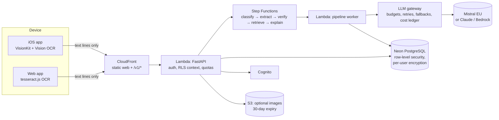

# LetterLens

Scan an official German letter. Understand it in your language. Never miss the deadline.

LetterLens reads letters from the tax office, the Jobcenter, health insurers, the
immigration office and landlords. It explains each letter in plain language,
finds the deadlines and amounts, and checks every date against the original text.
It gives general information, not legal advice. For an individual case, it hands
the letter over to a free counselling service, with the reader's consent.

| Client | For | Main functions |
|---|---|---|
| iOS app (SwiftUI) | People who receive letters | Document scanner, on-device text recognition, summary in 6 languages, deadline cards with calendar and reminders, questions, sharing with a counsellor |
| Web app (Next.js) | Readers and counselling services | The same reader flow with in-browser text recognition; a case inbox, German summaries, reply translation and statistics for funding reports |

## Results

Measured on the golden set of 126 letters (synthetic letters with unseen seeds,
OCR-noise variants and 12 hand-written letters) and on 96 red-team questions in
6 languages. Report: [backend/evals/reports/offline.md](backend/evals/reports/offline.md).

| Metric | Value |
|---|---|
| Dates or amounts shown as "verified" that are not in the letter | **0** (also 0 of 91 injected hallucinations, fault-injection run) |
| Explicit deadline recall / precision | 98.0 % / 94.1 % |
| Letter date accuracy, amount recall | 100 % / 100 % |
| Letter-type accuracy on unseen layouts (leave-one-template-out) | 97.8 %, calibration error 0.32 → 0.01 |
| Retrieval recall@4 | 99.1 % |
| Legal-advice requests caught (rules layer only) / false positives | 85.2 % / 0 % |
| Prompt-injection attempts caught | 100 % |

These numbers use the offline provider (deterministic rules). The live profile
runs the same suites with the real model; see [docs/ai/evaluation.md](docs/ai/evaluation.md).

## Architecture



The rule behind the design: **the model proposes, code verifies.** The model
extracts dates and amounts with a line reference. Deterministic code checks that
the cited line contains the value. Values that fail the check are shown as
"please check", never as facts. Details: [docs/architecture/overview.md](docs/architecture/overview.md).

## Repository

| Path | Content |
|---|---|
| [backend/](backend/) | Python 3.13: FastAPI API, pipeline, LLM gateway, grounding, classifier, RAG, safety, billing, tests, evaluation suite |
| [web/](web/) | Next.js static export, TypeScript, typed API client generated from the OpenAPI contract |
| [ios/](ios/) | SwiftUI app (XcodeGen) and the `LetterLensCore` Swift package |
| [infra/](infra/) | AWS CDK (Python) with cdk-nag, GitHub OIDC deploy role |
| [contracts/](contracts/) | OpenAPI document and response fixtures shared by all clients |
| [docs/](docs/) | Architecture, ADRs, AI evaluation, security, legal boundary, operations |

## Quick start (local, no accounts needed)

Prerequisites: Docker, [uv](https://docs.astral.sh/uv/), Node.js 22.

```bash
make seed   # PostgreSQL in Docker, migrations, demo data
make api    # API on http://localhost:8000 (offline model provider)
make web    # web app on http://localhost:3000
```

Sign in as `demo-client` (reader) or `counsellor-anna` (counselling service).
More: [docs/development.md](docs/development.md).

## Quality gates

```bash
make lint   # ruff, mypy --strict, eslint, tsc
make test   # 157 backend tests (with RLS isolation), infra assertions, web tests
make eval   # offline gate and fault-injection gate
cd ios/Packages/LetterLensCore && swift test   # Swift core and API contract tests
```

## Documentation

- [Deployment guide](docs/operations/deployment.md): the manual steps for AWS, Neon, Mistral, GitHub, Apple, Stripe
- [Architecture overview](docs/architecture/overview.md) and [decision records](docs/architecture/adr/)
- [AI pipeline](docs/ai/pipeline.md) and [evaluation](docs/ai/evaluation.md)
- [Threat model](docs/security/threat-model.md) and [data protection](docs/security/data-protection.md)
- [Legal-advice boundary (RDG)](docs/legal/rdg-boundary.md)
- [Runbook](docs/operations/runbook.md) and [cost model](docs/operations/cost.md)

## Status

The product is ready for a closed pilot after the checklist in the
[deployment guide](docs/operations/deployment.md#before-real-users-checklist).
The corpus and the legal boundary need a professional review before real users.
