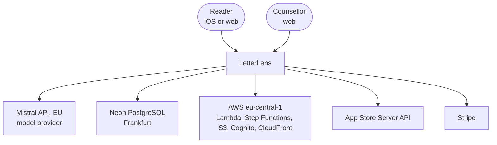

# Architecture overview

## 1. Purpose and constraints

LetterLens explains official German letters to people who are learning German.
The design follows from five constraints:

| Constraint | Effect on the design |
|---|---|
| A wrong deadline can harm a user. | The model proposes facts. Deterministic code verifies them. Unverified values are shown as "please check". |
| A legal assessment of an individual case is a regulated legal service (§ 2 RDG). | The product explains. A guardrail refuses individual advice and offers a counsellor. |
| Letters are among the most sensitive documents people own. | On-device OCR, pseudonymization before the model, per-user encryption, 30-day retention, EU processing. |
| The operating budget is 0 EUR. | Serverless always-free services, a free PostgreSQL, a free EU model tier. Paid upgrades are documented, not required. |
| One engineer builds and runs it. | A modular monolith: one Python package, one database, one deploy. |

## 2. Context

