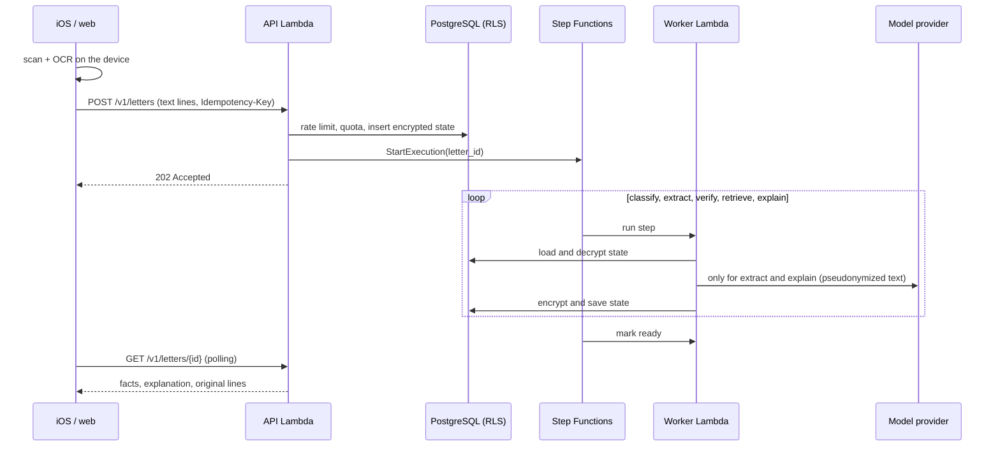

# Architecture overview

## 1. Purpose and constraints

LetterLens explains official German letters to people who are learning German.
The design follows from five constraints:

| Constraint | Effect on the design |
|---|---|
| A wrong deadline can harm a user. | The model proposes facts. Deterministic code verifies them. Unverified values are shown as "please check". |
| A legal assessment of an individual case is a regulated legal service (§ 2 RDG). | The product explains. A guardrail refuses individual advice and offers a counsellor. |
| Letters are among the most sensitive documents people own. | On-device OCR, pseudonymization before the model, per-user encryption, 30-day retention, EU processing. |
| The operating budget is 0 EUR. | Serverless always-free services, a free PostgreSQL, a free EU model tier. Paid upgrades are documented, not required. |
| One engineer builds and runs it. | A modular monolith: one Python package, one database, one deploy. |

## 2. Context

## 3. Components

The backend is one Python package, `letterlens`. Each module has one task.

| Module | Task |
|---|---|
| `api` | HTTP routes, request and response models, authentication, error format, security headers |
| `services` | Use cases: letters, questions, sharing, case inbox |
| `pipeline` | The steps classify, extract, verify, retrieve, explain, finalize, and the runners |
| `llm` | The gateway, the providers, versioned prompts, prices |
| `grounding` | German date and amount parsers, deadline rules, the verifier |
| `ml` | The letter-type classifier (dependency-free inference) |
| `rag` | The curated corpus and hybrid retrieval |
| `safety` | PII pseudonymization, the legal-advice guardrail, injection defence |
| `db` | Connection pool, row-level-security context, migrations, repositories |
| `crypto` | Envelope encryption (AES-256-GCM, per-user data keys) |
| `billing` | Stripe webhooks, App Store transaction verification |
| `handlers` | AWS Lambda entry points |

Dependencies point inwards: `api` → `services` → `pipeline` → `llm`, `grounding`, `rag`, `safety`.
The domain types in `domain.py` have no dependencies.

## 4. Request flow: a new letter

